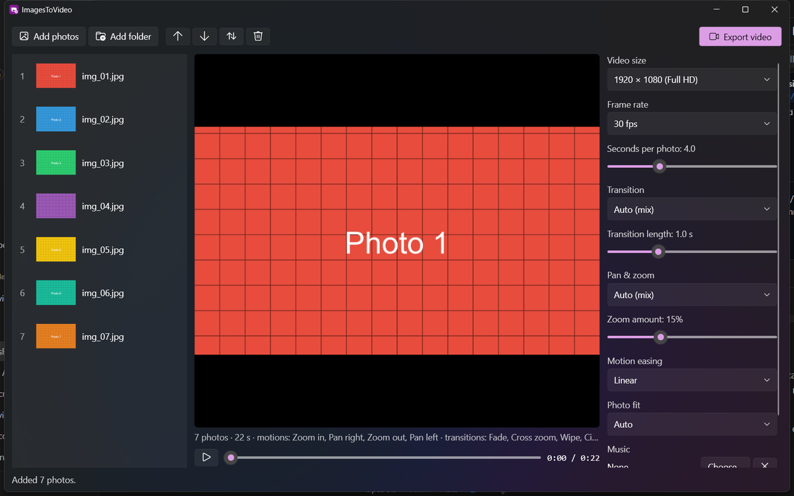

# ImagesToVideo

Turn a list of images into a beautiful video, with smooth **pan & zoom** (the "Ken Burns" effect) on every
photo, **transitions** between them, and optional **music**.


> **Built with [Claude Code](https://claude.com/claude-code) and the [REA MCP](https://github.com/morluto/rea).**
> Claude used REA (Reverse Engineer Anything) to study how an installed video editor (Wondershare Filmora)
> builds photo slideshows. It found that pan & zoom is a keyframed crop rectangle and catalogued the
> transitions. Claude then wrote this tool from scratch based on what it learned: first as a Python
> command-line engine, then as a native Windows app (C#/WPF), matching the reference app's native stack.
> [FINDINGS.md](FINDINGS.md) has the evidence, and records what was observed separately from the design
> choices made here. Nothing from Filmora was copied.

This repo has **two versions of the same engine**:

| | Windows app (`windows/`) | Command line (`imagestovideo/`) |
|---|---|---|
| Language | C# / WPF on .NET 9, Fluent theme | Python 3.10+ |
| Use it to | Add or drop photos, reorder them, preview live, and export with a progress bar | Script it, batch jobs, any OS |
| Engine | The same pan & zoom presets and 7 transitions, ported 1:1 | The original implementation |
| Output | H.264 MP4 through FFmpeg | H.264 MP4 through FFmpeg |

Both need [FFmpeg](https://ffmpeg.org/) (on Windows: `winget install Gyan.FFmpeg`).

## Windows app



**Install:** with the [.NET 9 SDK](https://dotnet.microsoft.com/download) installed, double-click `windows\build.bat`.
It publishes a single-file `ImagesToVideo.exe` (about 260 KB, using the .NET 9 Desktop Runtime) and installs
it to `%LOCALAPPDATA%\Programs\ImagesToVideo`, with Start Menu and Desktop shortcuts. To uninstall:

```bash
powershell -ExecutionPolicy Bypass -File windows\install.ps1 -Uninstall
```

**Use:**
- **Add photos:** use **Add photos** or **Add folder**, drag files or folders onto the window, or pass them on
  the command line (`ImagesToVideo.exe C:\Photos\Trip`).
- **Reorder:** move up/down, sort by name, or remove (Delete).
- **Preview:** drag the scrubber or press **Space** to play. Clicking a photo jumps the preview to it.
- **Settings:** size (Full HD, HD, 4K, vertical, square), frame rate, seconds per photo, transition and its length,
  pan & zoom preset and amount, easing, photo fit, and music. They're remembered between sessions.
- **Export video:** pick a file, then watch progress with a time estimate. Cancel any time. When it's done, use
  **Play video** or **Show in folder**.

The app's code is in `windows/`: `Engine/` (frame buffers, pan & zoom, transitions, timeline and FFmpeg
export) and `MainWindow.xaml(.cs)` (the UI).

## Command line

You need Python 3.10 or newer and FFmpeg on your PATH.

```bash
pip install -r requirements.txt
python -m imagestovideo path/to/photos -o holiday.mp4
```

The defaults are 1080p at 30 fps, 4 seconds per photo, 1-second transitions, and a different pan & zoom and
transition for each photo.

### Examples

```bash
# Vertical video for reels/shorts, with music
python -m imagestovideo photos -o reel.mp4 --size 1080x1920 --audio song.mp3

# Calm and classic: slow zoom-in on every photo with crossfades
python -m imagestovideo photos -o calm.mp4 --motion zoom_in --transition fade --duration 5 --easing smooth

# Energetic: random transitions, stronger motion, faster cuts
python -m imagestovideo photos -o fast.mp4 --transition random --zoom 0.3 --duration 2.5 --transition-duration 0.6

# Exact reference behaviour: 2x zoom per photo
python -m imagestovideo photos -o kenburns.mp4 --zoom 0.5
```

### Options

| Option | Default | Description |
|---|---|---|
| `inputs` | | Image files and/or folders (jpg, png, webp, bmp, tif, gif) |
| `-o, --output` | `slideshow.mp4` | Output file (H.264 MP4) |
| `--size` | `1920x1080` | Output size. Use `1080x1920` for vertical video |
| `--fps` | `30` | Frame rate |
| `--duration` | `4` | Seconds each photo is on screen |
| `--transition` | `auto` | `auto` (cycles), `random`, `none`, `fade`, `fade_black`, `wipe`, `push`, `cross_zoom`, `circle` or `pixelate` |
| `--transition-duration` | `1` | Seconds. At most half of `--duration` |
| `--motion` | `auto` | `auto` (cycles), `zoom_in`, `zoom_out`, `pan_left`, `pan_right`, `zoom_to_bottom_right` or `none` |
| `--zoom` | `0.15` | How far the motion moves in, 0–0.5 (0.5 = 2x zoom) |
| `--easing` | `linear` | `linear`, `smooth` or `sine` |
| `--fit` | `auto` | `cover` (crop to fill), `blur` (whole photo on a blurred background), or `auto` (blur only when the aspect ratios differ a lot, such as portrait photos in a landscape video) |
| `--audio` | | Music file. It fades in and out and is trimmed to the video length |
| `--order` | `name` | `name`, `date` (file modified time) or `given` |
| `--crf` | `18` | x264 quality (lower is better) |
| `--seed` | | Makes `--transition random` repeatable |

### Use it from Python

```python
from imagestovideo import Settings, collect_images, render

files = collect_images(["photos"])
render(files, "out.mp4", Settings(size=(1280, 720), transition="cross_zoom", motion="auto"))
```

## How the engine works

- **`imagestovideo/panzoom.py`:** each photo is fitted to the output aspect ratio (cropped, or placed on a
  blurred background) on a canvas slightly larger than the output. Each motion preset is a pair of crop
  rectangles, one for the start and one for the end of the clip. Every frame resamples the in-between
  rectangle with sub-pixel accuracy, so slow pans don't judder.
- **`imagestovideo/transitions.py`:** seven transitions written in numpy. Each takes the outgoing frame, the
  incoming frame and the progress (0–1).
- **`imagestovideo/render.py`:** places the photos on a timeline where consecutive photos overlap for the
  transition. Motion runs through the transitions, so the movement never stops. Raw frames are streamed
  straight into FFmpeg, which keeps memory use flat however many photos there are.

## License

GPL-3.0. See [LICENSE](LICENSE).
